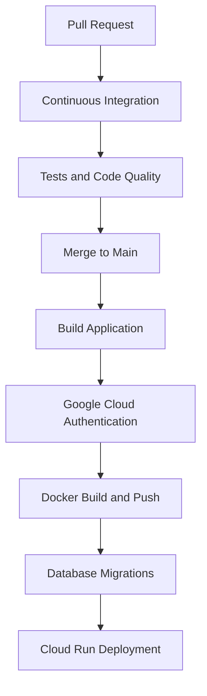

# Notely

[](https://github.com/MhmdRayanm7/learn-cicd-typescript-starter/actions/workflows/ci.yml)
[](https://github.com/MhmdRayanm7/learn-cicd-typescript-starter/actions/runs/45168431228)


A TypeScript web application developed as part of the [Boot.dev Learn CI/CD](https://www.boot.dev/courses/learn-ci-cd-github-docker-typescript) course, focusing on automated testing, cloud infrastructure, containerization, and continuous deployment.

## Tech Stack

| Category | Technologies |
| --- | --- |
| Backend | TypeScript, Node.js, Express |
| Database | Turso, libSQL, Drizzle ORM |
| CI/CD | GitHub Actions |
| Containerization | Docker |
| Cloud | Google Cloud Platform |
| Cloud Services | Cloud Build, Artifact Registry, Cloud Run |
| Security | IAM, OIDC, Workload Identity Federation |
| Testing & Code Quality | Vitest, ESLint, Prettier |

## CI/CD Pipeline



### Continuous Integration

- Automated unit tests and coverage
- Code formatting and linting
- Security-related linting rules
- Pull request validation

### Continuous Deployment

- Automated application and Docker builds
- Secure cloud authentication using WIF
- Container image publishing to Artifact Registry
- Database migrations with Drizzle
- Automated deployment to Google Cloud Run

## Local Development

Requires Node.js 22 or newer.

```bash
npm ci
```

Create a `.env` file:

```env
PORT=8080
```

Start the application:

```bash
npm run dev
```

Open http://localhost:8080.

Database functionality requires additional Turso configuration.

## Deployment Status

The complete CI/CD pipeline was successfully executed and verified on November 23, 2026.

Cloud resources were intentionally removed after completing the course to avoid unnecessary costs. The deployment workflow is preserved for reference.

[View the successful deployment](https://github.com/MhmdRayanm7/learn-cicd-typescript-starter/actions/runs/45168431228)

---

Built as part of the Boot.dev backend development learning path.
